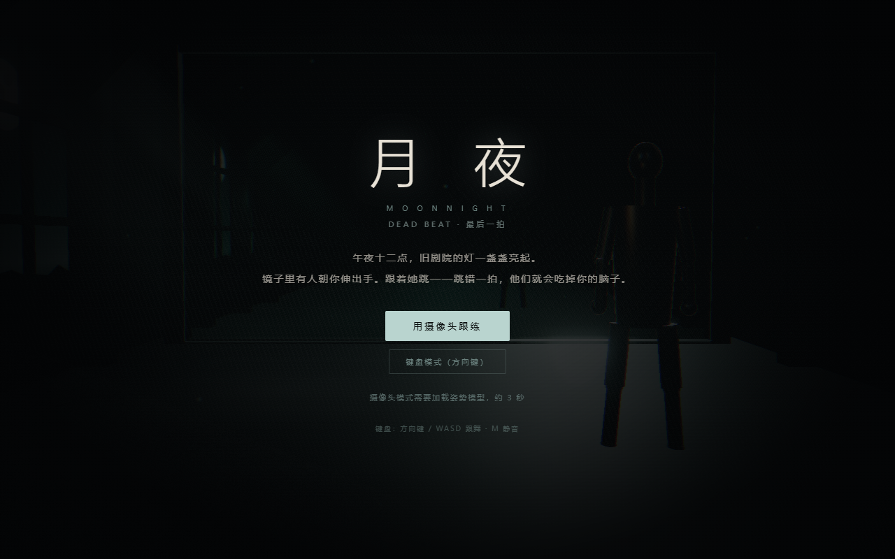
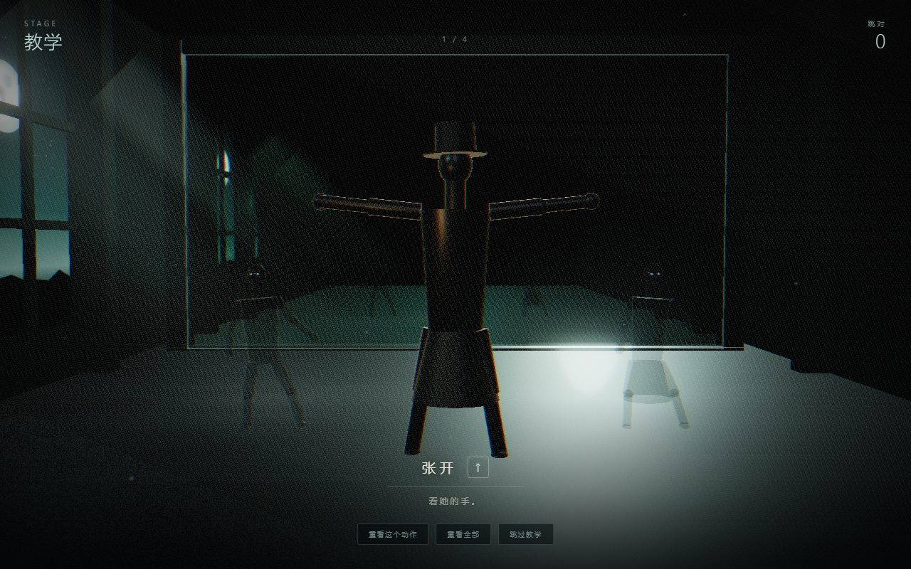
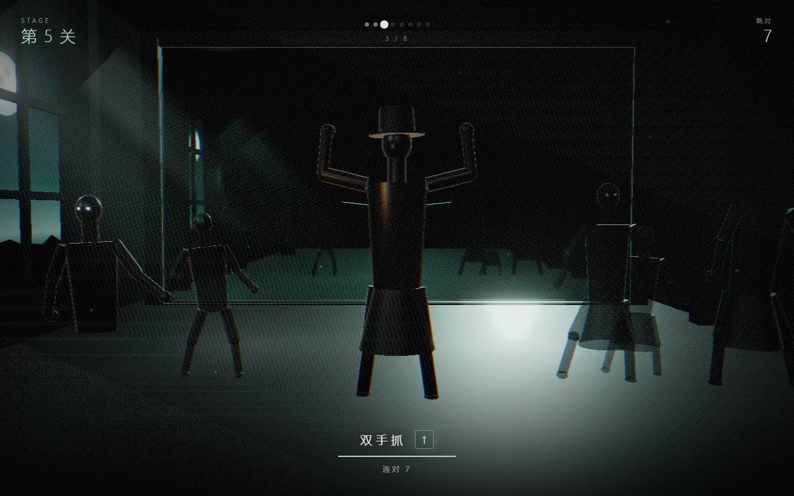

# 月夜 · MOONNIGHT

> **DEAD BEAT：最后一拍**
>
> 午夜十二点，旧剧院的灯一盏盏亮起。镜子里有人朝你伸出手。
> 跟着她跳——跳错一拍，他们就会吃掉你的脑子。

参与 **WaytoAGI 1024 超能 Coding 周末 · 游戏赛道**



## 在线试玩

| 入口 | 链接 |
|---|---|
| **国内镜像（推荐，大陆直连）** | <https://moonnight-c1n29gwia6s.qoder.zone/> |
| **GitHub Pages（主站）** | <https://denghui1835.github.io/moonnight/> |
| 配乐试听 | [GitHub Pages](https://denghui1835.github.io/moonnight/music/moonnight-metal.mp3) · [镜像](https://moonnight-c1n29gwia6s.qoder.zone/music/moonnight-metal.mp3) |

- 两个入口是同一份构建，内容一致；GitHub Pages 在国内部分网络/代理下会打不开，优先用镜像。
- 手机扫码（左：镜像，右：GitHub Pages）：

   

- 推荐桌面浏览器（Chrome / Edge）。摄像头模式需要授权；不方便开摄像头就选键盘模式，难度完全一致。
- 第一次进入摄像头模式会加载本地姿势模型（约 5.6 MB），之后走缓存。
- 本地兜底：`npm install` 后 `npm run dev`（<http://localhost:5173/>）；或 `npm run build && npm run preview`（<http://localhost:4173/moonnight/>）。Vite 的 base 是 `/moonnight/`，不要直接双击打开 `dist/index.html`。

## 这是什么

一个恐怖舞蹈游戏。你站在镜子前，镜子里有一个戴黑色礼帽的「人」在教你跳舞；
你身后的队尾站着一排东西——它们曾经也是来跳舞的人，跳错了，被吃掉了脑子，只剩怨魂留在这里。

它们一直在靠近。走到快要抓住你的时候，会像掉帧一样退回远处，再重来。
**你跳对了，这一晚就继续循环；你跳错了，这一晚就结束。**

| | |
|---|---|
|  |  |

## 玩法

- **摄像头模式**：跟着镜中人的动作跳，MediaPipe 实时识别你的身体，画面不上传。
- **键盘模式**：`↑ ↓ ← →`（或 `W A S D`）对应四个动作，难度与摄像头一致。
- **手机触控**：触屏设备自动显示底部四键舞蹈板，点按即可玩，无需外接键盘。
- **教学关**：第 0 关不会死，可「重看这个动作」「重看全部」，也可直接跳过。
- **肉鸽**：正式关跳错一次，僵尸立刻扑上来，回到第 1 关。
- **六关**：BPM 128 → 168，动作数 4 → 8；第 3 关起切入重金属编曲层。
- **终章**：跳完最后一支没教过的舞，队伍里第一个人的来历会被揭开。

## 操作

| 操作 | 键位 |
|---|---|
| 四个舞蹈动作 | `↑` `↓` `←` `→` 或 `W` `A` `S` `D` |
| 手机 / 平板 | 底部四键舞蹈板，点按即判定 |
| 静音 / 取消静音 | `M` |
| 重看教学 | 界面按钮 |

摄像头打不开、模型加载失败或拒绝授权时，游戏自动降级到键盘模式并恢复所有按钮，不会卡在加载页。

## 原创配乐

[`docs/music/moonnight-metal.wav`](docs/music/moonnight-metal.wav) —— **原创、程序合成**，65.66 秒 / 148 BPM / D 弗里几亚小调：
双轨失真吉他、双踩底鼓、贝斯跟 riff、鼓组过门与一段 solo，穿插乌鸦、心跳、门轴和远处惨叫。

- 由 `src/metal.ts`（编曲引擎）经 `src/metalRender.ts`（`OfflineAudioContext`）离线渲染导出；
- 游戏第 3 关起实时调度同一套编曲层，试听文件与实机听感一致；
- 无采样、无外部音源，未引用任何既有作品的旋律或 riff。仅参考 80 年代恐怖摇滚的氛围与硬摇滚配器。
- 细节：[docs/music/README.md](docs/music/README.md)

## 技术

| 模块 | 选型 |
|---|---|
| 构建 | Vite + TypeScript（strict） |
| 渲染 | Three.js r170 实时 3D：程序化人偶、真实镜面反射、Bloom、体积光、菲涅尔轮廓光；WebGL 不可用时自动退回 Canvas 2D 剪影 |
| 体感 | MediaPipe PoseLandmarker (lite)，wasm 与模型全量本地化，不依赖外网 |
| 判定 | 10 个加权姿态特征；键盘模式共用同一套节拍窗口 |
| 音频 | Web Audio 实时合成，25ms 调度 / 120ms 前瞻；音频时钟带单调回退与恢复重锚 |
| 金属层 | 实时与离线共用编曲引擎；`WaveShaper` 失真、多振荡器吉他、噪声+滤波鼓 |
| 兼容 | 摄像头失败自动降级并关闭轨道；移动端 375px 无横向溢出，触屏自动出现四键舞蹈板 |

姿势模型与 wasm 运行时来自 [MediaPipe](https://github.com/google-ai-edge/mediapipe)（Apache-2.0），已随仓库本地化。

## 本地运行

```bash
npm install
npm run dev      # http://localhost:5173
npm run build    # 产出 dist/
npm run preview  # 预览生产构建
npm run qa       # 桌面 E2E（32 项，需先启动 npm run dev）
npm run touchqa  # 手机触控 E2E（21 项，375×812 设备模拟）
```

## 目录

```
src/
  main.ts        入口、界面切换、输入、HUD
  game.ts        游戏状态机、关卡、判定、僵尸循环
  render3d.ts    Three.js 镜厅：人偶、镜面、体积光、后期
  stage.ts       Canvas 2D 兜底场景与剪影渲染
  rig.ts         正向运动学骨架与姿态匹配
  moves.ts       动作库与关卡编排
  pose.ts        MediaPipe 体感
  audio.ts       实时音乐与音效调度
  metal.ts       金属编曲引擎（实时 + 离线共用）
  metalRender.ts OfflineAudioContext 渲染并导出 WAV
public/
  wasm/          MediaPipe 运行时（本地化）
  models/        pose_landmarker_lite.task
docs/
  故事-最终版.md  完整剧本
  作品介绍.md     评审向介绍
  演示脚本.md     3 分钟分镜与录制步骤
  验证记录.md     修复与测试记录
  music/         原创金属配乐与说明
  screenshots/   截图
tools/
  qa.mjs         CDP 桌面 E2E 测试（32 项）
  touchqa.mjs    CDP 手机触控 E2E 测试（21 项）
```

## 设计文档

- [作品介绍](docs/作品介绍.md)
- [完整故事](docs/故事-最终版.md)
- [项目规划书](docs/规划书.md)
- [故事设定](docs/故事设定.md)
- [验证记录](docs/验证记录.md)
- [演示脚本](docs/演示脚本.md)

## 原创性

- 代码、美术、音乐全部原创。
- 美术为程序化剪影，没有任何图片素材进入游戏。
- 配乐与音效全部由 Web Audio 合成，没有第三方曲目或采样。
- 编舞为原创动作，未使用任何已有作品的编舞。
- 仅以《Thriller》的恐怖叙事氛围与《Beat It》的硬摇滚配器作为风格参考，未复制任何旋律、riff 或受版权保护的段落。

## 状态

WaytoAGI 1024 超能 Coding 周末参赛作品（2026-10-24 ~ 10-25）。
构建与浏览器端验证记录见 [docs/验证记录.md](docs/验证记录.md)。
