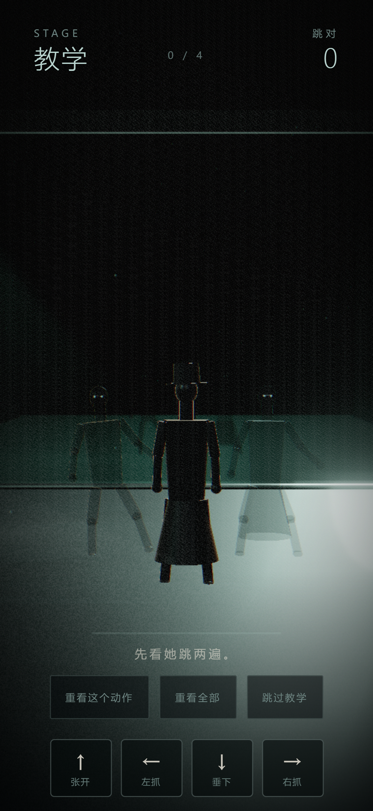
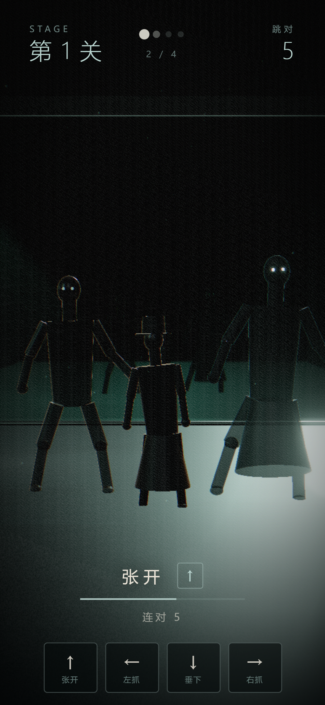
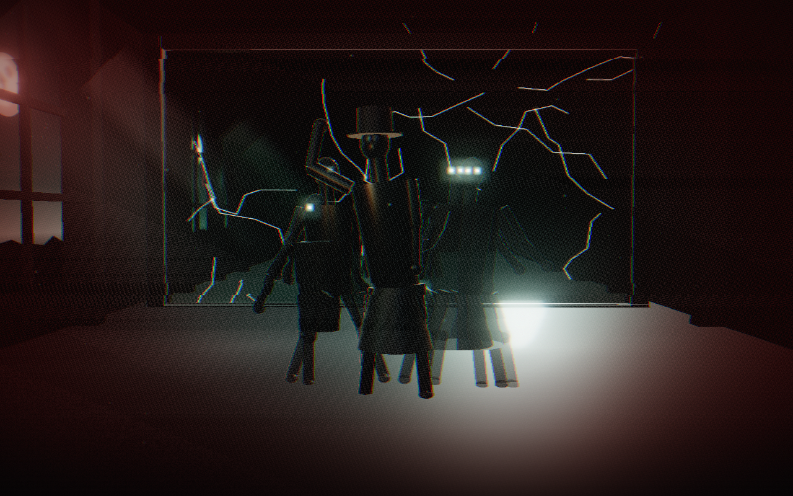
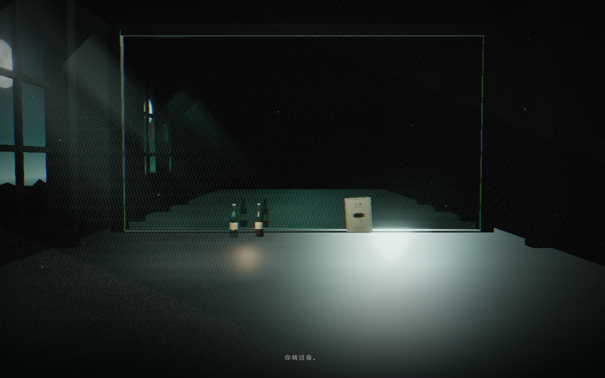

# 《月夜》MOONNIGHT · 作品介绍

> **DEAD BEAT：最后一拍**
>
> 午夜十二点，旧剧院的灯一盏盏亮起。镜子里有人朝你伸出手。
> 跟着她跳——跳错一拍，他们就会吃掉你的脑子。

参赛：**WaytoAGI 1024 超能 Coding 周末 · 游戏赛道**

**在线试玩：<https://denghui1835.github.io/moonnight/>**


---

## 一句话

一个用摄像头替你照镜子的恐怖舞蹈游戏：镜中的领舞戴着黑色礼帽，身后的队伍一直在靠近；你只能靠跟对每一拍活下去。

## 玩法

1. **跟练**：镜中人做一个动作，你在同一个节拍里做出来。
2. **键盘模式**：方向键 / WASD 对应 `↑ 张开、↓ 垂下、← 左手抓、→ 右手抓`，难度与摄像头完全一致。
3. **手机触控**：触屏设备自动出现底部四键舞蹈板，点按即判定，评委可以直接用手机试玩。
4. **教学关**：第 0 关不会死，可以「重看这个动作」「重看全部」，也可以直接「跳过教学」。
5. **肉鸽**：正式关一旦跳错，无论僵尸离你多远，都会瞬间扑上来。回到第 1 关。
6. **六关**：BPM 从 128 一路升到 168，动作数从 4 个增加到 8 个；第 3 关起切换重金属编曲层。
7. **终章**：跳完最后一支没教过的舞，你会知道队伍里第一个人的来历。

| | |
|---|---|
|  |  |
|  |  |

## 操作

| 操作 | 键位 |
|---|---|
| 跟舞（四个方向） | `↑` `↓` `←` `→` 或 `W` `A` `S` `D` |
| 手机 / 平板 | 底部四键舞蹈板，点按即判定 |
| 静音 / 取消静音 | `M` |
| 教学重看 | 界面按钮 |
| 摄像头模式 | 允许浏览器使用摄像头即可，无需穿戴设备 |

摄像头不可用、模型加载失败或用户拒绝授权时，游戏会自动切换到键盘模式，并保留本次进度入口，不会卡在加载界面。

## 恐怖从哪来

- **一直在靠近**：僵尸不会一次冲上来。它们循环地逼近，在快要抓住你的一瞬间退回远处，再重来。你跳对时，这条循环是安全的；你跳错时，它们不再等。
- **镜子**：整块屏幕就是镜面。领舞只存在于镜中，房间里没有这个人。
- **看不清**：全部角色都是程序化黑色剪影，没有贴图、没有面孔，恐怖来自轮廓和节奏。
- **声音**：心跳、门轴、乌鸦、远处惨叫都长在节拍上；第 3 关起，失真吉他和双踩接管配乐。



## 故事

完整剧本见 [故事-最终版.md](故事-最终版.md)。

剧院在午夜开门。镜中的舞者戴着黑色礼帽，等你把这支没跳完的舞跳完。
队伍里的人越来越多，老树上的乌鸦脚上系着一条褪色的红绳。
跳到最后一拍，她放下了手——那是她一直没有教你的动作。



## 原创配乐

[试听（MP3）](https://denghui1835.github.io/moonnight/music/moonnight-metal.mp3) · 仓库内 WAV：`docs/music/moonnight-metal.wav`

`docs/music/moonnight-metal.wav` 是**完全原创、程序合成**的重金属乐曲：65.66 秒、148 BPM、D 弗里几亚小调，双轨失真吉他、双踩底鼓、贝斯跟 riff、鼓组过门与一段 solo，并穿插乌鸦、心跳、门轴和远处惨叫。

它由项目内的 `src/metal.ts`（编曲引擎）经 `src/metalRender.ts`（`OfflineAudioContext` 离线渲染）生成并导出为 16-bit 立体声 WAV；游戏从第 3 关起实时调度同一套编曲层，因此音频文件与实机听感一致。

**没有采样、没有外部音源，也没有引用任何既有作品的旋律或 riff。** 仅参考 80 年代恐怖摇滚的叙事氛围与硬摇滚配器。

细节见 [music/README.md](music/README.md)。

## 技术亮点

| 模块 | 实现 |
|---|---|
| 渲染 | Three.js r170 实时 3D：程序化人偶（正向运动学骨架）、真实镜面反射（`Reflector`）、Bloom、体积光、菲涅尔轮廓光；零图片素材，地面/窗/尘埃/演出单全部由 canvas 程序生成 |
| 降级 | WebGL 不可用时自动退回 Canvas 2D 剪影场景，玩法与判定完全一致 |
| 体感 | MediaPipe PoseLandmarker (lite)，模型与 wasm 全量本地化，不依赖外网 |
| 判定 | 10 个加权姿态特征，0–1 匹配分；键盘模式走同一套节拍窗口 |
| 音乐 | Web Audio 实时调度（25ms 轮询 / 120ms 前瞻），25 种合成音色；音频时钟带单调回退与恢复重锚 |
| 金属层 | 离线渲染与实时播放共用同一编曲引擎，保证试听文件 = 实机听感 |
| 兼容 | 摄像头失败自动降级、轨道显式关闭、按钮恢复、桌面与手机竖屏各自构图 |

## 目录

```
src/        game / render3d / stage / rig / moves / pose / audio / metal / metalRender
docs/       设计、故事、验证记录、演示脚本、角色卡、配乐
public/     本地化的 MediaPipe wasm 与姿态模型
```

## 运行

```bash
npm install
npm run dev      # http://localhost:5173
npm run build    # 产出 dist/
```

---

海报与角色卡：[poster.png](poster.png) · [主角卡.png](主角卡.png)（一句话 / 3D 人偶 / 游戏内） · [角色卡-女.png](角色卡-女.png) · [角色卡-男.png](角色卡-男.png)
